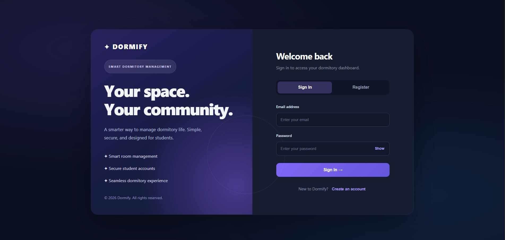
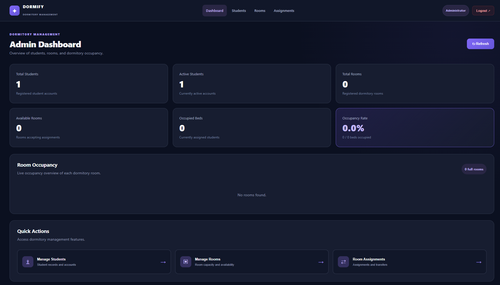
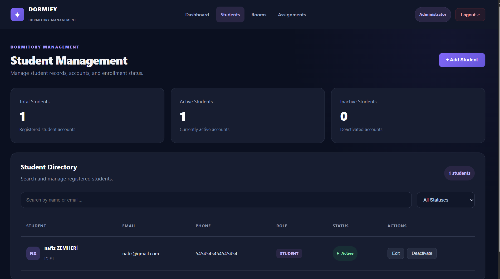
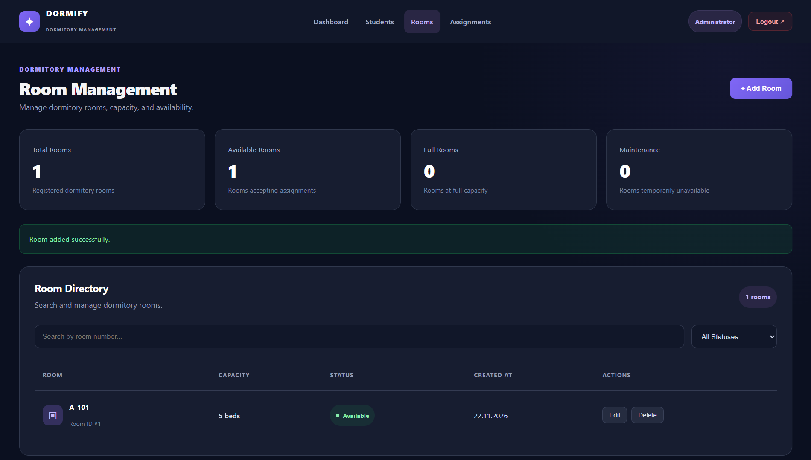
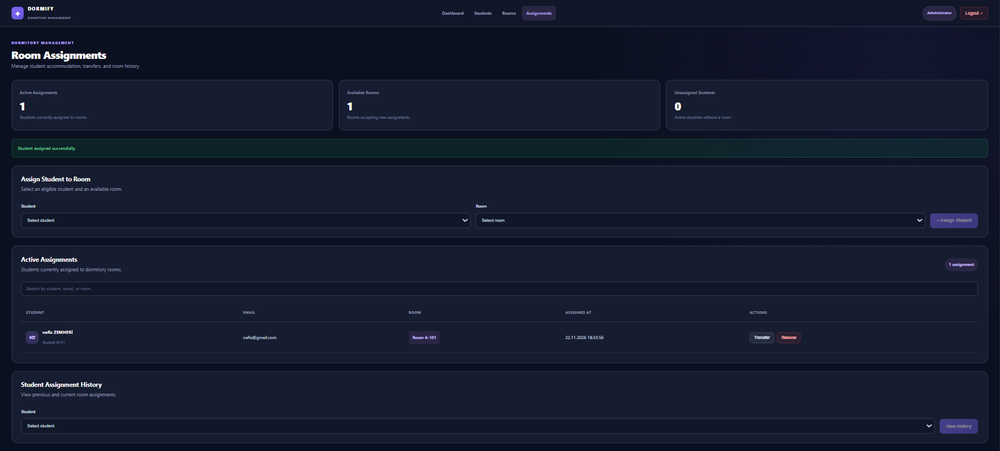

# 🏠 DORMIFY — Dormitory Management System

DORMIFY is a full-stack dormitory management application built with **Spring Boot, React, PostgreSQL, and Docker**.

The application provides role-based access for administrators and students, allowing dormitory staff to manage rooms, student records, and room assignments through a web interface.

## 🚀 Features

### Authentication & Security
- User registration and login
- JWT-based authentication
- BCrypt password hashing
- Role-based authorization (ADMIN / STUDENT)
- Protected API endpoints using Spring Security

### Admin Features
- Create, update, and deactivate student records
- Create, view, update, and delete rooms
- Assign students to rooms
- Transfer students between rooms
- Release students from rooms
- View room assignment history

### Student Features
- View personal profile
- View current room assignment
## 📸 Application Screenshots

### Login Page


### Admin Dashboard


### Student Management


### Room Management


### Room Assignments


---
## 🛠️ Tech Stack

| Layer | Technologies |
|---|---|
| Backend | Java 21, Spring Boot, Spring Security, Spring Data JPA |
| Frontend | React 19, Vite 8, React Router, Axios |
| Database | PostgreSQL 17 |
| Authentication | JWT, BCrypt |
| Containerization | Docker, Docker Compose, Nginx |
| API Documentation | Swagger / OpenAPI |
| Testing | JUnit 5, Mockito, Spring Boot Test |
| Build Tools | Maven, npm |

## 📁 Project Structure

```text
dormitory-management-system/
├── backend/
│   ├── src/
│   ├── Dockerfile
│   ├── .dockerignore
│   └── pom.xml
├── frontend/
│   ├── src/
│   ├── public/
│   ├── Dockerfile
│   ├── .dockerignore
│   ├── nginx.conf
│   └── package.json
├── compose.yaml
├── .gitignore
└── README.md
```

## 🐳 Running with Docker

### Prerequisites

- Docker Desktop
- Docker Compose

### 1. Clone the repository

```bash
git clone <repository-url>
cd dormitory-management-system
```

### 2. Configure environment variables

Create a `.env` file inside the `backend` directory:

```env
DB_PASSWORD=your_database_password
JWT_SECRET=your_secure_jwt_secret
```

Use a strong, randomly generated JWT secret compatible with the application's JWT configuration.

**Never commit your `.env` file to Git.**

### 3. Build and start the application

```bash
docker compose --env-file backend/.env up --build -d
```

Docker Compose starts three services:

- PostgreSQL database
- Spring Boot backend
- React frontend served by Nginx

### 4. Access the application

| Service | Address |
|---|---|
| Frontend | http://localhost:3000 |
| Backend | http://localhost:8080 |
| Swagger UI | http://localhost:8080/swagger-ui/index.html |

### 5. Stop the application

```bash
docker compose --env-file backend/.env down
```

The PostgreSQL Docker volume is preserved when stopping the application.

## 📚 API Endpoints

### Authentication

| Method | Endpoint | Description |
|---|---|---|
| POST | `/api/auth/register` | Register a new user |
| POST | `/api/auth/login` | Authenticate and receive a JWT |

### Student Management

| Method | Endpoint | Description |
|---|---|---|
| GET | `/api/users/me` | Get the authenticated user's profile |
| GET | `/api/users/students` | List students |
| POST | `/api/users/students` | Create a student |
| PUT | `/api/users/students/{id}` | Update a student |
| PATCH | `/api/users/students/{id}/deactivate` | Deactivate a student |

### Room Management

| Method | Endpoint | Description |
|---|---|---|
| GET | `/api/rooms` | List rooms |
| POST | `/api/rooms` | Create a room |
| PUT | `/api/rooms/{id}` | Update a room |
| DELETE | `/api/rooms/{id}` | Delete a room |

### Room Assignments

| Method | Endpoint | Description |
|---|---|---|
| POST | `/api/assignments` | Assign a student to a room |
| PUT | `/api/assignments/release/{studentId}` | Release a student from a room |
| PUT | `/api/assignments/transfer` | Transfer a student to another room |
| GET | `/api/assignments/me` | View the authenticated student's room |
| GET | `/api/assignments` | List room assignments |
| GET | `/api/assignments/history/{studentId}` | View a student's assignment history |

Administrative operations require the ADMIN role. Student-specific operations are protected by role-based access control.

## 🧪 Testing

The backend includes automated tests covering authentication and room assignment operations.

To run the tests locally, ensure PostgreSQL is available and the required environment variables are configured.

From the `backend` directory, run:

```bash
mvn clean test
```

The test suite includes:

- Authentication service unit tests
- Room assignment service unit tests
- Spring Boot application context test

## 🔒 Security

- JWT-based stateless authentication
- BCrypt password hashing
- Role-based access control
- CORS configuration
- Environment-based secret management
- Sensitive files excluded from Git

## 📌 Project Status

**Active development**

The core application, authentication, room management, student management, room assignments, automated tests, and Docker integration are implemented.

## 👩‍💻 Author

**Beyza Nur Zemheri**

Computer Engineering Student — TED University